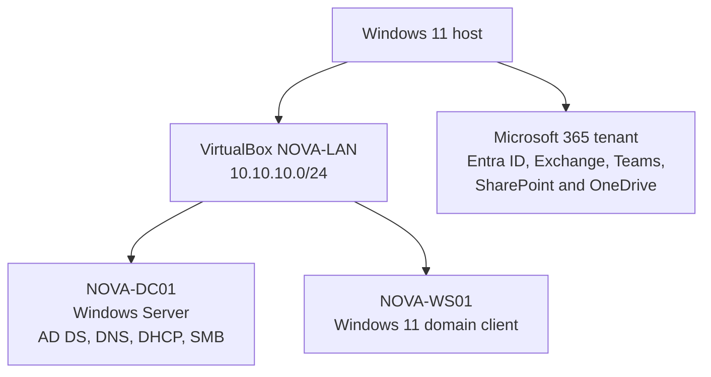

# Enterprise IT Support Lab

Hands-on small-business IT environment built to practise realistic Tier 1 Help Desk and junior systems administration work across Windows Server, Active Directory, Microsoft 365, Microsoft Entra ID, Microsoft Intune, Exchange Online, Teams, SharePoint, OneDrive, networking, access control, security, and basic PowerShell.

> **Scope:** This is a self-directed lab built around a simulated company environment. I completed every documented task hands-on and verified the results with captured evidence.

## Project goals

- Build and operate a representative small-company IT environment.
- Practise complete user lifecycles: onboarding, access changes, troubleshooting, security response, and offboarding.
- Resolve realistic support requests using evidence rather than guessing.
- Apply least privilege, identity verification, and group-based access control.
- Produce documentation and automation that can be explained in an interview.

## Project documentation

- [HD-001: Unable to Sign In](tickets/HD-001-jordan-sign-in.md)
- [SR-002: HR to Finance Department Transfer](tickets/SR-002-nina-department-transfer.md)
- [INC-001: Domain Client Received an APIPA Address](incidents/INC-001-apipa-dhcp-unavailable.md)
- [INC-002: Suspected Microsoft 365 Account Compromise](incidents/INC-002-m365-suspected-account-compromise.md)
- [Employee Onboarding and Offboarding Procedure](onboarding-offboarding/employee-lifecycle-procedure.md)
- [KB-001: Secure Active Directory Password Reset](knowledge-base/KB-001-secure-ad-password-reset.md)
- [PowerShell script notes](powershell/README.md)
- [Active Directory user audit script](powershell/Export-ADUserAudit.ps1)
- [Exchange Online mailbox inventory script](powershell/Export-ExchangeMailboxInventory.ps1)
- [Microsoft Intune Mobile Device Management Lab](intune-mobile-device-management/README.md)
- [Screenshot evidence gallery](screenshots/README.md)

## Environment overview



| Component | Configuration |
| --- | --- |
| Domain | `corp.novacore.test` |
| Domain controller | `NOVA-DC01`, `10.10.10.10` |
| Client | `NOVA-WS01`, Windows 11, domain joined |
| Lab network | VirtualBox NAT network `10.10.10.0/24` |
| DHCP scope | `10.10.10.100` to `10.10.10.200` |
| DNS | AD-integrated DNS hosted on `NOVA-DC01` |
| Departments | Finance, HR, IT and Sales |
| Cloud tenant | Microsoft 365 lab tenant with Entra ID, Exchange Online, Teams, SharePoint, OneDrive and Intune |

## Technologies used

- Windows Server and Windows 11
- Active Directory Domain Services
- DNS and DHCP
- Group Policy concepts and domain password policy
- NTFS and SMB share permissions
- Microsoft 365 Admin Center
- Microsoft Entra ID
- Microsoft Intune and Intune Company Portal
- Exchange Online and Exchange Online PowerShell
- Microsoft Teams, SharePoint and OneDrive
- Conditional Access in report-only mode
- PowerShell ActiveDirectory and ExchangeOnlineManagement modules
- VirtualBox

## Active Directory and Windows administration

### Configuration completed

- Promoted `NOVA-DC01` as the domain controller for `corp.novacore.test`.
- Joined `NOVA-WS01` to the domain and verified domain authentication.
- Created departmental OUs, users and security groups.
- Configured a domain password policy with a 12-character minimum, complexity, password history, and account-lockout controls.
- Created departmental SMB shares for Finance, HR, IT and Sales.
- Applied group-based access using an AGDLP-style pattern, including `GG-Finance` nested in `DL-Finance-Share-RW`.
- Delegated selected user-management capabilities to a Help Desk group and verified the delegated boundary.
- Verified both successful and intentionally denied access scenarios.

### Representative support tasks

- Reset user passwords and required changes at next sign-in.
- Reviewed enabled, locked, expired and password-state properties before modifying accounts.
- Onboarded a new HR user and assigned department access.
- Processed an employee department transfer from HR to Finance.
- Removed obsolete HR access, granted Finance access through security groups, updated the AD department attribute, and verified both allowed and denied SMB access.
- Updated mapped drives after an access change.
- Offboarded a fictional employee and removed access safely.
- Installed and tested software on the Windows client.

## Networking and troubleshooting

- Configured and authorized DHCP with the correct gateway, DNS server and domain suffix options.
- Used `ipconfig`, `ping`, `nslookup` and related Windows tools to isolate connectivity and name-resolution problems.
- Diagnosed an APIPA address caused by DHCP/network configuration problems and restored normal addressing.
- Recovered from a VirtualBox host-storage incident that prevented normal VM operation.
- Verified client-to-domain-controller connectivity and access to internal resources.

## Microsoft 365 and Entra ID

### Identity and access

- Created fictional cloud users for Sales and HR roles.
- Assigned and removed Microsoft 365 Business Premium licences.
- Created assigned security groups for Sales and HR.
- Configured user profile and employment attributes.
- Reset passwords, forced password changes, blocked and restored sign-in, and revoked active sessions.
- Reviewed sign-in logs and authentication methods during a simulated account-compromise investigation.
- Created a dedicated unlicensed Help Desk administrator account.
- Assigned the Microsoft Entra **Helpdesk Administrator** role and verified that it could reset a standard user's password but could not reset a Global Administrator.
- Completed MFA registration for the privileged Help Desk account.

### Conditional Access and security

- Created `CA-Require-MFA-Jordan-Test` targeting one test user and all cloud resources.
- Left the policy in **Report-only** mode because Security Defaults remained enabled.
- Verified through sign-in logs that the policy result was **User action required**.
- Avoided disabling Security Defaults or enforcing a broad policy without a tested emergency-access design.

### Mobile device management

- Configured Microsoft Intune for iOS device enrollment.
- Enrolled a personal iPhone through the Intune Company Portal.
- Applied and verified an iOS compliance policy.
- Validated Outlook access and Microsoft Authenticator number matching.
- Assigned Microsoft To Do as a required mobile application.
- Tested selective retirement, re-enrollment and compliance recovery.
- Documented the complete project in the [Microsoft Intune Mobile Device Management Lab](intune-mobile-device-management/README.md).

### Collaboration and files

- Created a private `Sales Department` Microsoft Team with an owner and member.
- Verified that an unauthorized HR user could not access the private Team.
- Created and edited files in the Team-backed SharePoint document library.
- Shared a OneDrive document with a specific user using edit permission and verified successful collaboration.
- Tested removal of group and Team memberships during offboarding.

## Exchange Online

- Created the `HR Requests` shared mailbox.
- Granted Jordan Kim **Full Access** and **Send As** permissions.
- Opened the shared mailbox in Outlook and tested send/receive mail flow.
- Used Exchange message trace to verify delivered messages between users and the shared mailbox.
- Installed and connected to the Exchange Online PowerShell module.
- Used PowerShell to inventory mailboxes and confirm recipient types.
- Verified shared-mailbox permissions with `Get-EXOMailboxPermission` and `Get-EXORecipientPermission`.
- Verified delivery with `Get-MessageTraceV2`.
- Exported a mailbox inventory to CSV.

## User lifecycle exercises

### Onboarding

- Created accounts with the correct OU, department, title and company attributes.
- Assigned licences, security groups and collaboration access.
- Issued temporary passwords and required users to choose private passwords.
- Verified sign-in, email and resource access from the user's perspective.

### Security response

- Disabled a suspected-compromised account before investigation.
- Revoked sessions and reviewed sign-in activity.
- Reset credentials while sign-in remained blocked.
- Reviewed registered authentication methods for unexpected entries.
- Re-enabled the account only after the checks were complete and verified that the old password failed.

### Offboarding

- Blocked sign-in and revoked sessions.
- Converted a mailbox to a shared mailbox before licence removal.
- Granted authorized mailbox and OneDrive access to an administrator.
- Removed departmental group and Team memberships.
- Removed the Microsoft 365 licence.
- Retained the user object to avoid risking access to the retained shared mailbox.

## PowerShell

I used PowerShell for practical Active Directory and Exchange Online administration, including account queries, permission checks, message tracing and CSV exports. I understand the purpose of the commands used and how the pipeline moves data from one stage to the next.

### Active Directory user audit

```powershell
Get-ADUser -Filter * `
  -SearchBase "OU=Departments,OU=NovaCore,DC=corp,DC=novacore,DC=test" `
  -Properties Department,PasswordLastSet,LastLogonDate |
Select-Object Name,SamAccountName,Department,Enabled,PasswordLastSet,LastLogonDate |
Export-Csv "$env:USERPROFILE\Desktop\NovaCore-User-Audit.csv" -NoTypeInformation
```

This report was opened and verified after export. It also confirmed a completed HR-to-Finance employee transfer.

### Exchange Online examples

```powershell
Connect-ExchangeOnline -UserPrincipalName <admin-UPN>

Get-EXOMailbox -ResultSize Unlimited |
Select-Object DisplayName,PrimarySmtpAddress,RecipientTypeDetails

Get-EXOMailboxPermission -Identity hr@<tenant>.onmicrosoft.com

Get-EXORecipientPermission -Identity hr@<tenant>.onmicrosoft.com

Disconnect-ExchangeOnline -Confirm:$false
```

Tenant-specific identifiers are sanitized in the public portfolio.

## Selected incidents and outcomes

| Scenario | Investigation | Resolution and verification |
| --- | --- | --- |
| Client received an APIPA address | Confirmed VirtualBox DHCP was disabled and checked the VM hosting the lab DHCP service | Started `NOVA-DC01`, then verified a valid lease, gateway, DNS server and domain suffix |
| User could not authenticate | Reviewed account state, expiration and password condition | Performed a verified temporary-password reset, required a password change and confirmed sign-in |
| Employee transferred departments | Reviewed OU placement, AD attributes, group membership and share access | Moved the user, updated department data, replaced HR membership with Finance membership, then verified Finance access and HR denial |
| Suspected Microsoft 365 compromise | Blocked sign-in, revoked sessions, reviewed logs and authentication methods | Reset credentials safely, found no unexplained activity, re-enabled access and verified the old password failed |
| Shared mailbox access and mail flow | Checked delegation, Outlook access and message trace | Confirmed Full Access, Send As and delivered bidirectional mail |
| VirtualBox VM failed because host storage was exhausted | Checked VM state and host disk usage | Recovered sufficient storage and restored VM operation without destructive reset actions |

## Security decisions demonstrated

- Verified identity before password resets.
- Used temporary passwords and required users to choose private replacements.
- Applied access through security groups instead of direct user ACLs.
- Used a limited Helpdesk Administrator account instead of Global Administrator for routine support.
- Preserved Security Defaults while testing Conditional Access safely in report-only mode.
- Blocked access before investigating suspected compromise.
- Avoided deleting cloud identities when doing so could endanger retained mailbox access.
- Kept credentials, tenant IDs and other secrets out of documentation.

## Repository structure

```text
enterprise-it-support-lab/
├── README.md
├── incidents/
├── intune-mobile-device-management/
├── knowledge-base/
├── onboarding-offboarding/
├── powershell/
├── screenshots/
└── tickets/
```

