# Microsoft Intune Mobile Device Management Lab

## Overview

I configured Microsoft Intune in my Microsoft 365 lab tenant and used it to enroll, secure, monitor, and reprovision a personal iPhone. I applied an iOS compliance policy, verified mobile email and MFA, deployed a required application, tested a selective Retire action, and confirmed successful re-enrollment.

This project demonstrates practical endpoint administration while protecting personal data on a personally owned device.

## Environment

| Component | Configuration |
| --- | --- |
| Microsoft 365 | Microsoft 365 E5 trial with Microsoft Intune |
| Identity | Microsoft Entra ID test user |
| Device | Personal iPhone 13 Pro |
| Operating system | iOS 18.7.8 |
| Enrollment app | Intune Company Portal |
| Productivity apps | Microsoft Outlook and Microsoft To Do |
| Authentication | Microsoft Authenticator with number matching |

## Solution overview

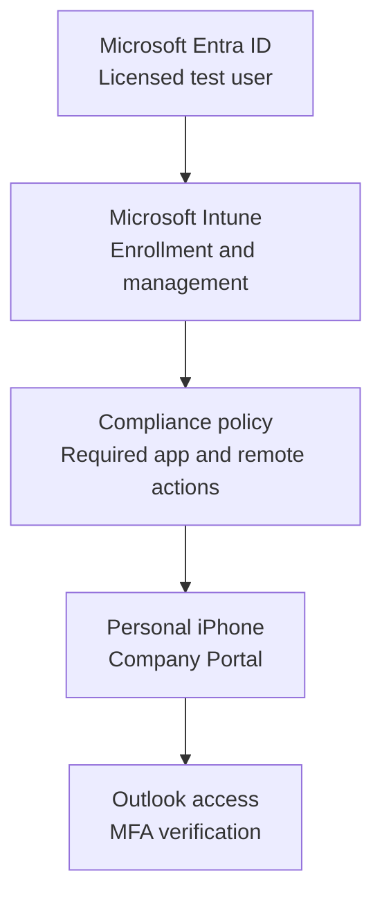

## What I configured

1. I verified the Intune MDM authority and available licensing in the tenant.
2. I created and uploaded an Apple MDM Push certificate for iOS enrollment.
3. I assigned the required Microsoft 365 licence to a dedicated test user.
4. I enrolled a personal iPhone through the Intune Company Portal.
5. I created and assigned the `iOS Personal Device Compliance Lab` policy.
6. I required a device password and set iOS 18.0 as the minimum operating system version.
7. I configured immediate noncompliance marking for failed policy checks.
8. I added the test user's mailbox to Outlook and completed MFA registration with number matching.
9. I assigned Microsoft To Do as a required application and confirmed it installed and opened.
10. I used the Intune Retire action to remove organizational management data while preserving personal content.
11. I re-enrolled the iPhone and confirmed that management, access, and compliance returned successfully.
12. I reviewed device details, compliance reporting, and Intune audit logs.

## Verification results

| Check | Result |
| --- | --- |
| Device enrollment | Company Portal completed enrollment and the iPhone appeared in Intune |
| Ownership | Intune recorded the iPhone as a personal device |
| Compliance | The assigned policy reported 1 compliant device and 0 noncompliant devices |
| Mobile email | Outlook displayed the test user's inbox |
| MFA | Microsoft Authenticator completed a two-digit number-match challenge |
| Application deployment | Microsoft To Do installed and opened on the managed iPhone |
| Selective retirement | The device record was removed while personal data remained available |
| Reprovisioning | The iPhone re-enrolled and returned to a compliant state |
| Auditing | Intune audit logs recorded successful enrollment, sync, policy, app, and Retire activity |

## Troubleshooting and resolutions

| Situation | Resolution |
| --- | --- |
| The original Microsoft 365 trial had expired | I activated a Microsoft 365 E5 trial and assigned its licence to the test user |
| The test user's password was unavailable | I reset the password in the Microsoft 365 admin center and completed sign-in |
| New settings took time to appear | I refreshed the admin center, triggered a device sync, and allowed time for service propagation |
| Company Portal showed Microsoft To Do as downloading after the app opened | I restarted Company Portal and confirmed the status updated to Installed |

## Security and privacy decisions

- I used a dedicated test identity for enrollment and application testing.
- I used a compliance policy to verify password protection and a supported iOS version.
- I chose the Retire action for a personal device so organizational management data could be removed while personal content stayed intact.
- I kept user addresses, tenant identifiers, device identifiers, and certificate identifiers out of the public evidence.

## Evidence

### Tenant and enrollment foundation

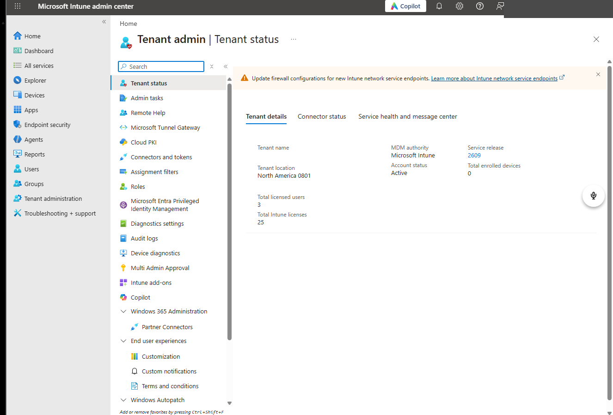

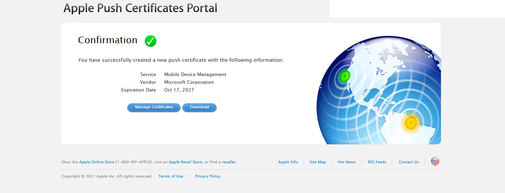

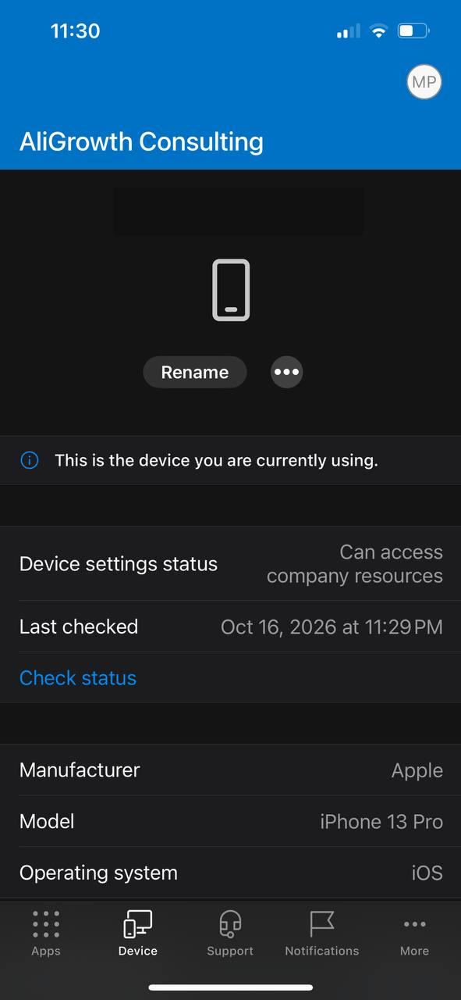

### Compliance and application management

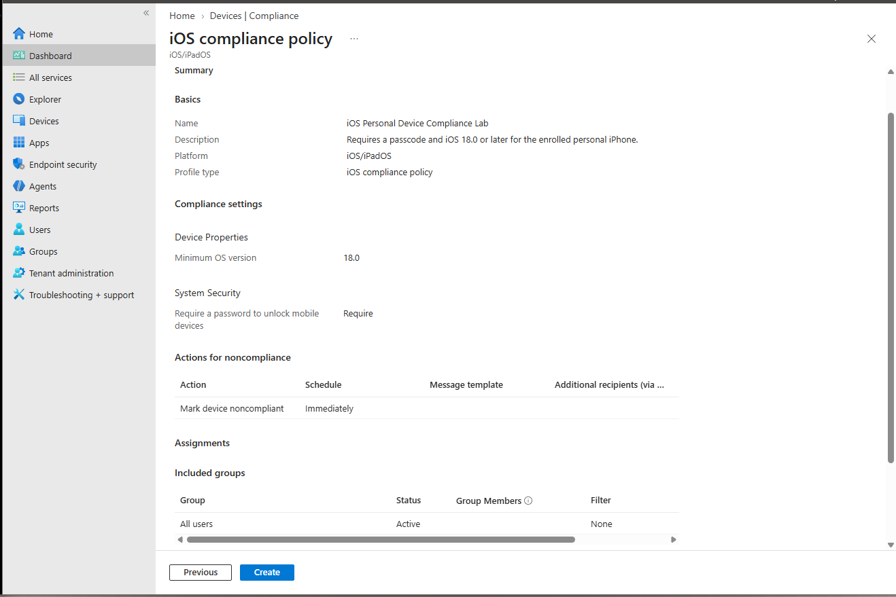

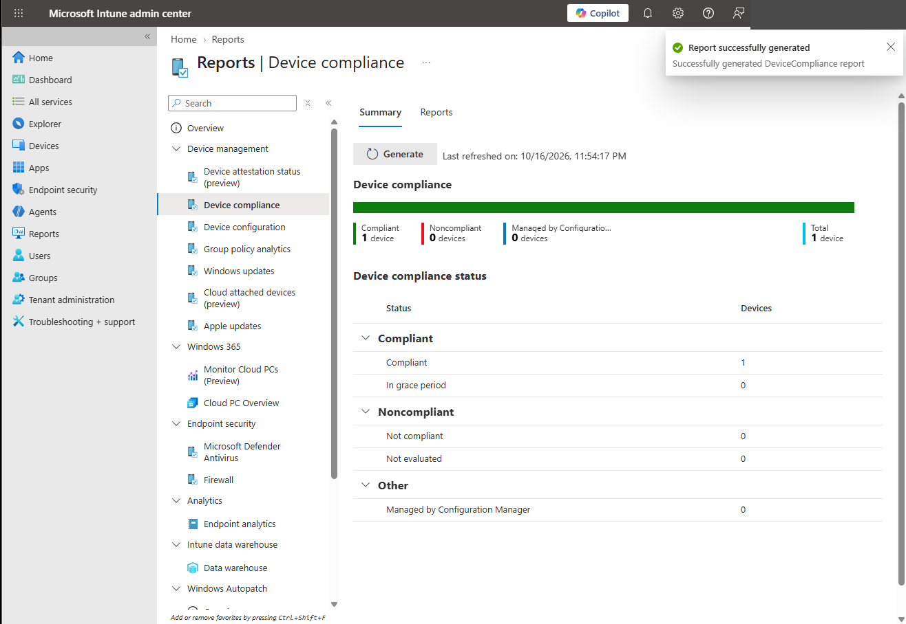

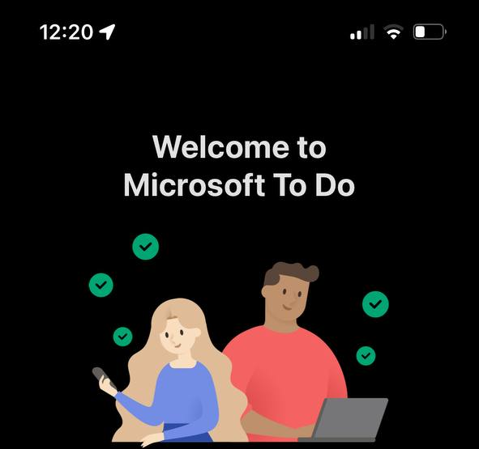

### Selective retirement and reprovisioning

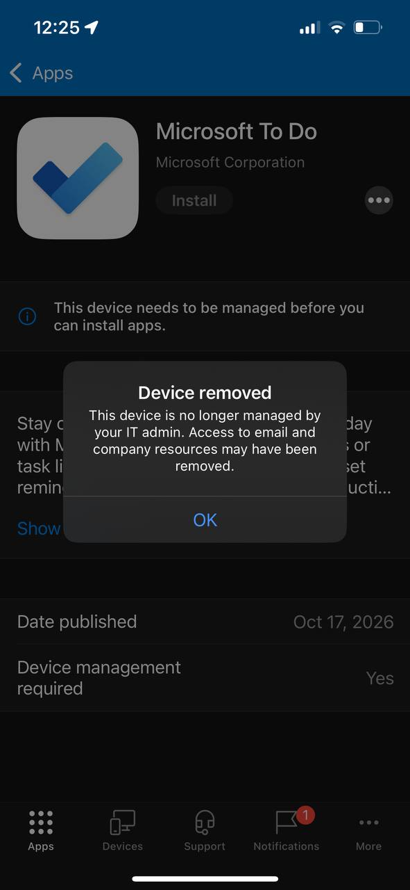

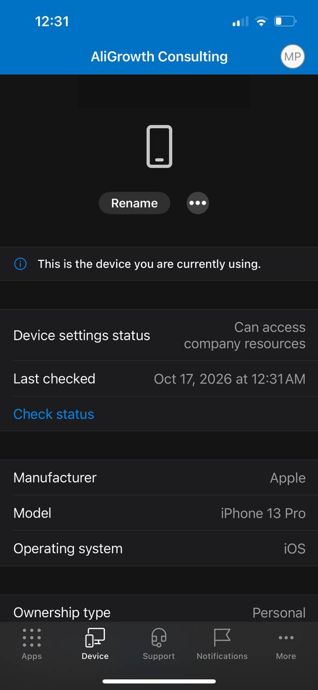

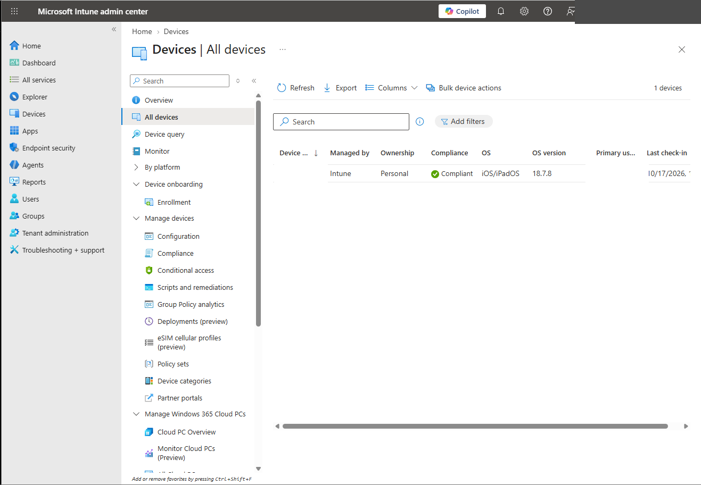

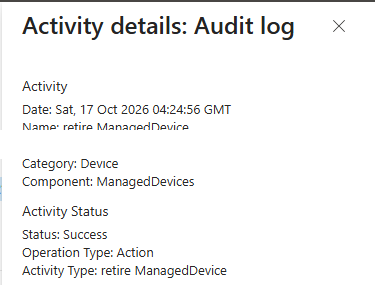

## Skills demonstrated

- Microsoft Intune tenant readiness and iOS enrollment
- Microsoft Entra ID user licensing
- Apple MDM Push certificate configuration
- iOS compliance policy creation and assignment
- Mobile application assignment and status validation
- Outlook and MFA validation on a managed device
- Selective retirement and device reprovisioning
- Device, compliance, and audit-log review

