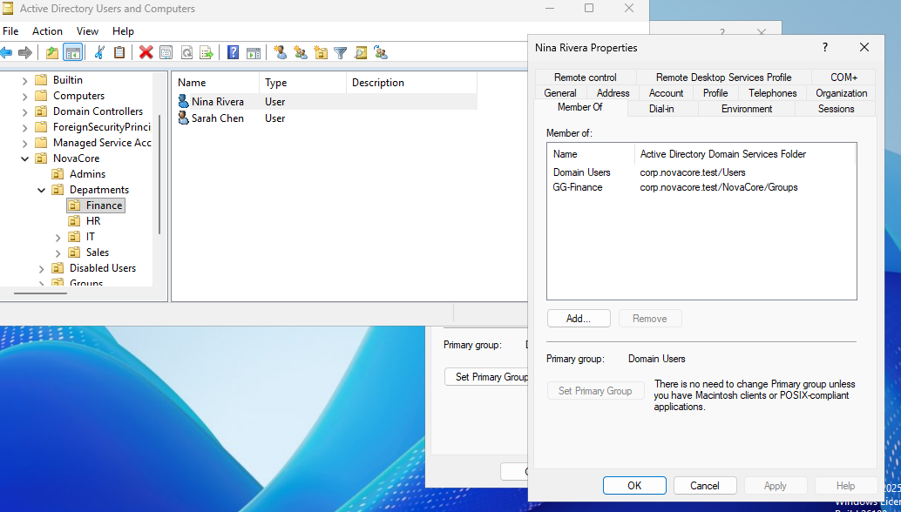
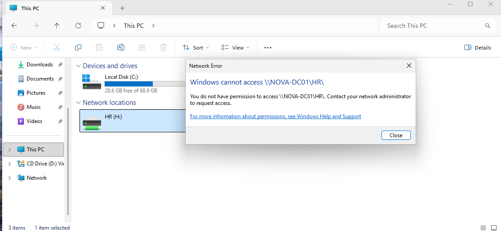
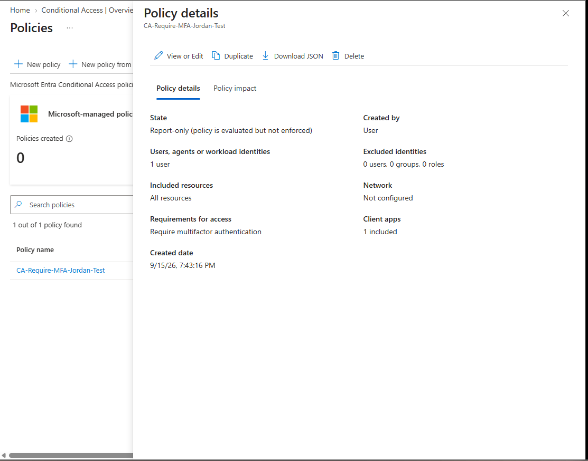
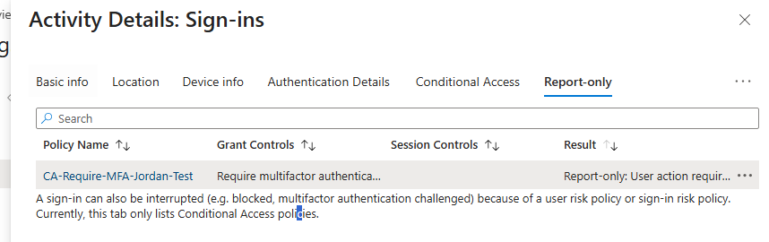
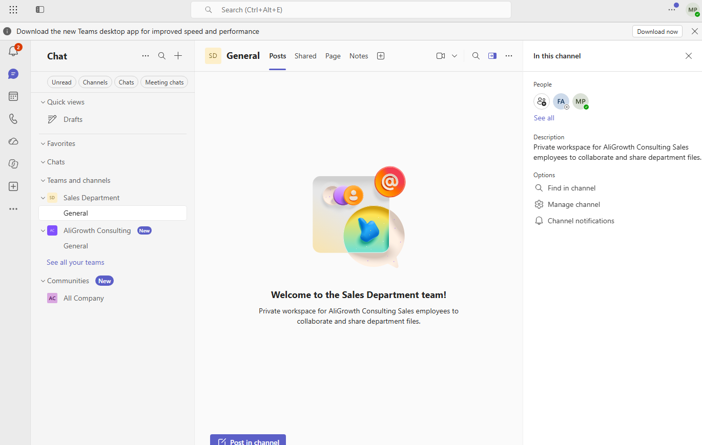
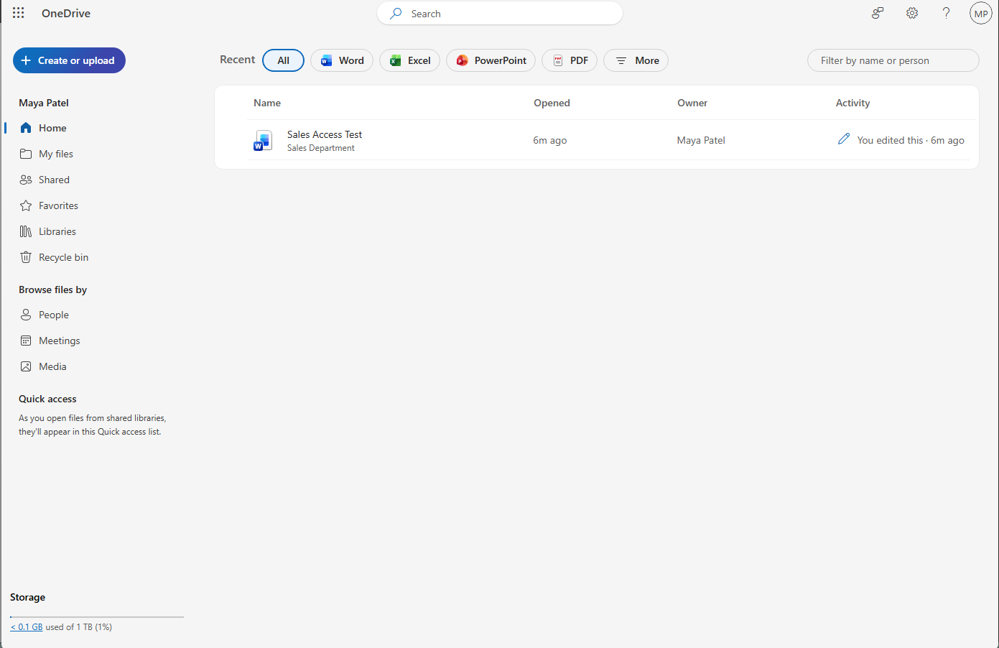
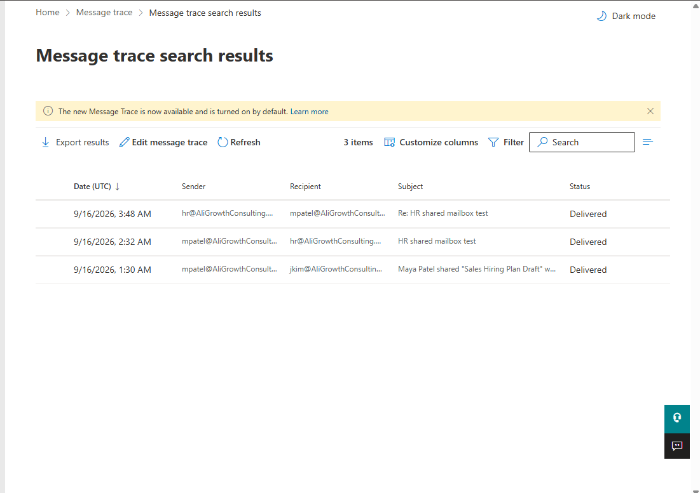

# Screenshot Evidence

The screenshots in this folder show completed administrative changes and verification results from the personal lab. Employee accounts are fictional test users. The lab owner's administrator name and lab tenant details are visible with permission.

## Active Directory and file access

### Finance group membership

Nina Rivera appears in the Finance OU with membership in `GG-Finance` after the approved department transfer.

### HR access removed

The transferred user receives an access denied response when attempting to open the HR share.

## Microsoft Entra ID

### Conditional Access policy configuration

The policy targets one test user, includes all resources, requires multifactor authentication and remains in report-only mode.

### Report-only evaluation

The sign-in log shows that the policy evaluated the test sign-in and returned a report-only user-action-required result.

## Microsoft 365 collaboration

### Private Sales team

The `Sales Department` team was created with its General channel and department description.

### Team file visible in OneDrive

The `Sales Access Test` document from the Sales Department library appears in the user's OneDrive recent items, showing how a Team file is surfaced through Microsoft 365.

## Exchange Online

### Delivered mail flow

Exchange message trace shows delivered messages between the HR shared mailbox and the test users.

## Selection criteria

- Each screenshot supports a specific completed task or verification result.
- Generic landing pages and empty administration screens were excluded.
- Error screens that did not add useful troubleshooting evidence were excluded.
- Lab account names and tenant email addresses are retained with the owner's permission. No passwords or access tokens are included.
